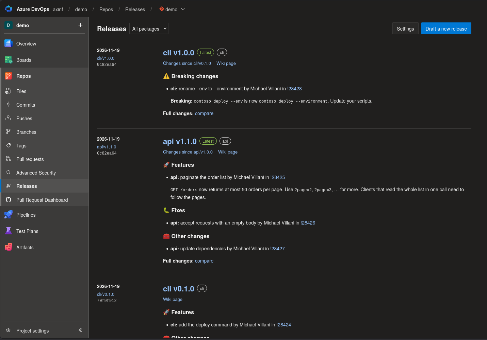
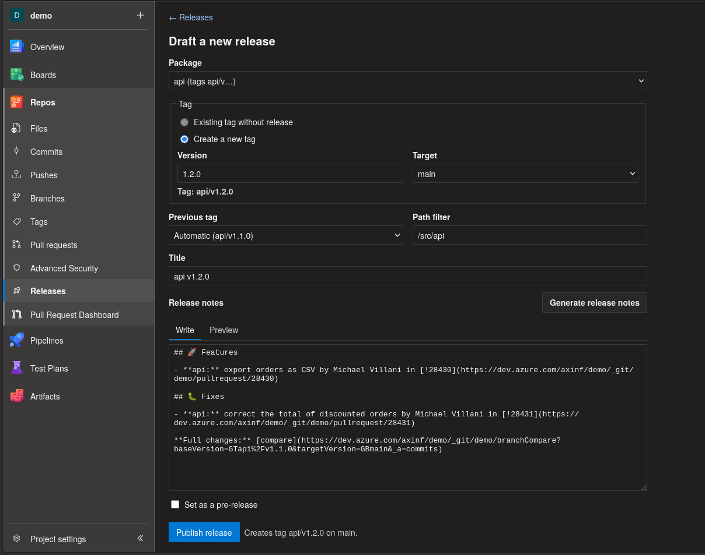
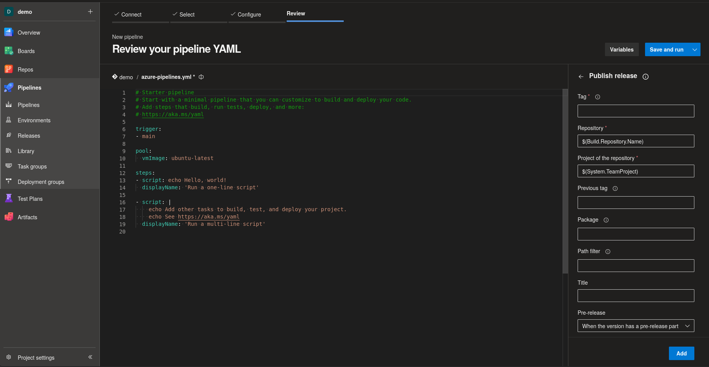
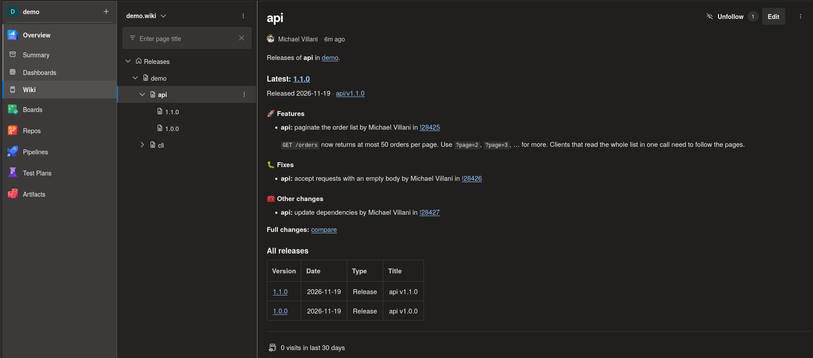

<p align="center">
  
</p>

<h1 align="center">Releases for Azure DevOps</h1>

<p align="center">
  GitHub-style releases for Azure Repos: release notes from merged pull requests,<br>
  release pages in your project wiki, and release notes in Renovate pull requests.
</p>

<p align="center">
  <a href="https://github.com/axiansinfoma/ado-releases/actions/workflows/ci.yml"></a>
  <a href="https://github.com/axiansinfoma/ado-releases/blob/main/LICENSE"></a>
</p>

---

Azure DevOps has tags, but no releases. This extension adds them:

- **Release notes from merged pull requests.** For a new tag, it collects the pull requests merged since the previous tag and groups them by [Conventional Commits](https://www.conventionalcommits.org/) type: breaking changes, features, fixes and other. Each line names the author and links the pull request, as on GitHub. A `## Release notes` section in a pull request description is included verbatim.
- **Release pages in the project wiki.** One page per release and an overview per package and repository. People can read them, and they live outside your source repositories.
- **Release notes in Renovate pull requests.** Each package gets a `releases.json` in [Renovate's custom datasource](https://docs.renovatebot.com/modules/datasource/custom/) format, so Renovate pull requests for your internal packages carry release notes, like those for packages hosted on GitHub.

It works with monorepos (one tag series per package, e.g. `tools/acme/v1.2.3`) and needs no backend service: everything is stored in the project wiki's Git repository.



> **Status:** early development, in production use by the authors. Expect changes until 1.0.

## Contents

- [What you get](#what-you-get)
- [Installation](#installation)
- [Releases page](#releases-page)
- [Pipeline task: Publish release](#pipeline-task-publish-release)
- [Renovate](#renovate)
- [CLI](#cli)
- [How it works](#how-it-works)
- [Permissions](#permissions)
- [Limitations](#limitations)
- [Contributing](#contributing)

## What you get

| Component | Use it to |
|---|---|
| **Releases** page in Azure Repos | browse releases, draft a release with generated notes and a new tag, edit or delete a release |
| Pipeline task **Publish release** (`PublishRelease@0`) | publish a release automatically after your pipeline creates a tag |
| CLI | preview notes locally and backfill releases for existing tags |

All three share one core library and write the same data, so you can mix them.

## Installation

The extension targets Azure DevOps Services. It isn't listed publicly on the Visual Studio Marketplace yet. Until it is, publish it under your own Marketplace publisher:

1. Clone the repository and set `publisher` in `vss-extension.json` to your publisher ID.
2. Build and package it, see [CONTRIBUTING.md](https://github.com/axiansinfoma/ado-releases/blob/main/CONTRIBUTING.md), and upload the `.vsix` in the Marketplace under **Manage publisher**.
3. Share the extension with your organization, then install it from **Organization settings › Extensions › Shared**.

When installing, an organization administrator approves the extension's scope **Code (read and write)**. The Releases page uses it to read repositories, create tags and write to the wiki.

## Releases page

The extension adds **Releases** to the Repos menu. For the selected repository it shows:

- **The release list**, newest first. Each release shows **Latest** and **Pre-release** badges, the rendered notes, and links to the tag, to the changes since the previous tag and to the wiki page. In monorepos you can filter by package.
- **Draft a new release**, as on GitHub:
  1. Choose the package and either an existing tag without a release or a new version. A new tag is created on the chosen branch when you publish, as a lightweight tag: annotated tags would need the broader scope `vso.code_manage`.
  2. Select **Generate release notes**. The previous tag is detected automatically, and you can override it. For a new tag, the next version is proposed from the pull request titles: `feat` → minor, `fix` → patch, `!` → major. The title is filled in from the last part of the package name, e.g. `acme v1.2.3`.
  3. Edit the notes with a Markdown preview, mark the release as a pre-release if needed, and publish.

  

- **A page per release** that you can link to directly. You can edit its title, notes and pre-release flag, or delete it. Deleting removes the release from the wiki and keeps the Git tag.
- **Settings** per project: wiki project, wiki repository, branch and root page. The defaults are the project wiki, its default branch and the root page `Releases`. The project wiki is found automatically, also after a project rename.

The page acts as the signed-in user; see [Permissions](#permissions).

## Pipeline task: Publish release

Add the task after the step that creates the tag:

```yaml
- task: PublishRelease@0
  inputs:
    tag: tools/acme/v$(version)
    pathFilter: /src/tools/acme      # monorepos: only changes below this path
    # previousTag: tools/acme/v1.1.0 # default: detected
    # ifExists: skip                 # skip | fail | replace (default: skip, safe for re-runs)
    # wiki: MyProject.wiki           # default: the project wiki
    # dryRun: true                   # plan only: no tag, no wiki commit
```

The task runs with the job access token. It sets the output variables `releaseVersion`, `releaseUrl` and `wikiCommitId`, and attaches the release notes to the run summary.



## Renovate

Define a custom datasource that reads a package's `releases.json` from the wiki repository, and point your dependencies at it:

```json
{
  "customDatasources": {
    "acme": {
      "defaultRegistryUrlTemplate": "https://dev.azure.com/myorg/MyProject/_apis/git/repositories/MyProject.wiki/items?path=/.releases/MyRepo/{{packageName}}/releases.json&versionDescriptor.version=wikiMaster&$format=octetStream&api-version=7.1",
      "format": "json"
    }
  },
  "hostRules": [
    { "matchHost": "dev.azure.com", "hostType": "custom.acme", "token": "{{ secrets.ADO_TOKEN }}" }
  ]
}
```

- **Host rule.** Renovate registers its Azure DevOps platform token for the host type `azure` and doesn't send it with custom datasource requests. The extra host rule supplies a token that can read the wiki repository.
- **Existing dependencies.** To keep a dependency's versions from its registry (e.g. a container registry) and only add release notes, use a package rule with `overrideDatasource: "custom.acme"` and `overridePackageName` set to the package path.
- **Notes per update.** Renovate embeds the notes of the target version. It doesn't combine the notes of skipped intermediate versions, but each release page links the package's full history.

## CLI

Use the CLI to preview release notes and to backfill releases for tags that existed before you installed the extension. It needs Node.js 20 or later:

```sh
git clone https://github.com/axiansinfoma/ado-releases.git && cd ado-releases
npm ci && npm run build
export ADO_TOKEN=...   # Microsoft Entra bearer token, or ADO_PAT=... for a personal access token

# print the notes a tag would get
node packages/cli/dist/cli.js notes --org https://dev.azure.com/myorg --project MyProject \
  --repository MyRepo --tag tools/acme/v1.2.3 --path /src/tools/acme

# plan a release without writing anything
node packages/cli/dist/cli.js publish --org https://dev.azure.com/myorg --project MyProject \
  --repository MyRepo --tag tools/acme/v1.2.3 --path /src/tools/acme --dry-run --out ./out

# publish releases for all existing tags of a package, oldest first, each dated by its tag
node packages/cli/dist/cli.js backfill --org https://dev.azure.com/myorg --project MyProject \
  --repository MyRepo --prefix tools/acme --path /src/tools/acme
```

`--help` lists all options.

## How it works

```
source repository                project wiki repository (e.g. MyProject.wiki)
  tag tools/acme/v1.2.3  ─────►    /Releases.md                                  index of repositories
                                   /Releases/<repo>.md                           repository overview
                                   /Releases/<repo>/<package>.md                 package overview, latest notes
                                   /Releases/<repo>/<package>/1.2.3.md           one page per release
                                   /.releases/<repo>/<package>/releases.json     for Renovate
                                   /.releases/<repo>/<package>/index.json        all release records
```



- **Packages.** A tag `<prefix>/v<semver>` belongs to the package `<prefix>`. A plain `v<semver>` tag belongs to a package named after the repository.
- **Previous tag.** By default, the previous tag is the highest tag of the same package below the new version. For a stable version, pre-release tags are skipped, so the notes of `1.2.0` cover everything since `1.1.0`.
- **Release date.** A release is dated by its tag: the tagger date of an annotated tag, the commit date of a lightweight tag, or the publish time for a tag created with the release. Renovate gets this date as `releaseTimestamp`, so publishing an old tag later doesn't make it look new.
- **Atomic writes.** Each publish is one commit to the wiki repository, made through the Git Pushes API. If the branch moved in the meantime, it retries.
- **Rebuildable data.** Each release page carries its record as hidden metadata, and all derived files can be rebuilt from `index.json`. Files under `/.releases/` don't appear in the wiki tree and use plain names, so other tools can build their URLs.

## Permissions

| Who | Needs | For |
|---|---|---|
| Users of the Releases page | **Contribute** on the wiki repository | publishing, editing and deleting releases |
| | **Create tag** on the source repository | creating a new tag from the page |
| Pipeline task (build service identity `<Project> Build Service (<org>)`) | **Contribute** on the wiki repository | publishing releases |
| | **Read** on the source repository | reading tags, commits and pull requests |
| | **Create tag** on the source repository | only with the input `createTagOnCommit` |

Set permissions on the wiki repository under **Project settings › Repositories › `<Project>.wiki`**. If your project limits job access tokens to referenced repositories, reference the wiki repository in the pipeline, e.g. with a `checkout` step or `uses: repositories`.

## Limitations

- Azure DevOps Services only; Azure DevOps Server isn't supported.
- Git repositories only, and only tags of the form `[<prefix>/]v<semver>`.
- Deleting a release keeps its Git tag; delete the tag separately if needed.
- Renovate shows the notes of the target version only; see [Renovate](#renovate).

## Contributing

Issues and pull requests are welcome. [CONTRIBUTING.md](https://github.com/axiansinfoma/ado-releases/blob/main/CONTRIBUTING.md) explains how to build, test and release, and [AGENTS.md](https://github.com/axiansinfoma/ado-releases/blob/main/AGENTS.md) describes the structure and conventions.

## License

[Mozilla Public License 2.0](https://github.com/axiansinfoma/ado-releases/blob/main/LICENSE)
